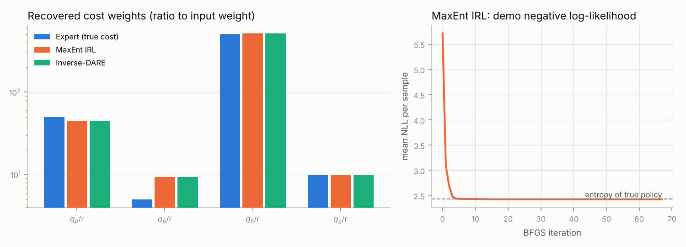
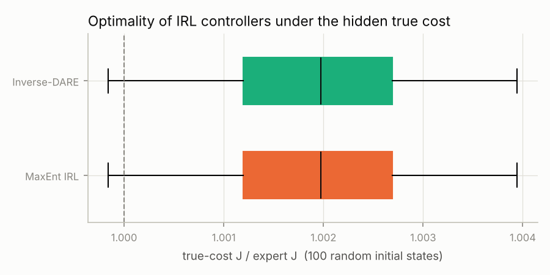
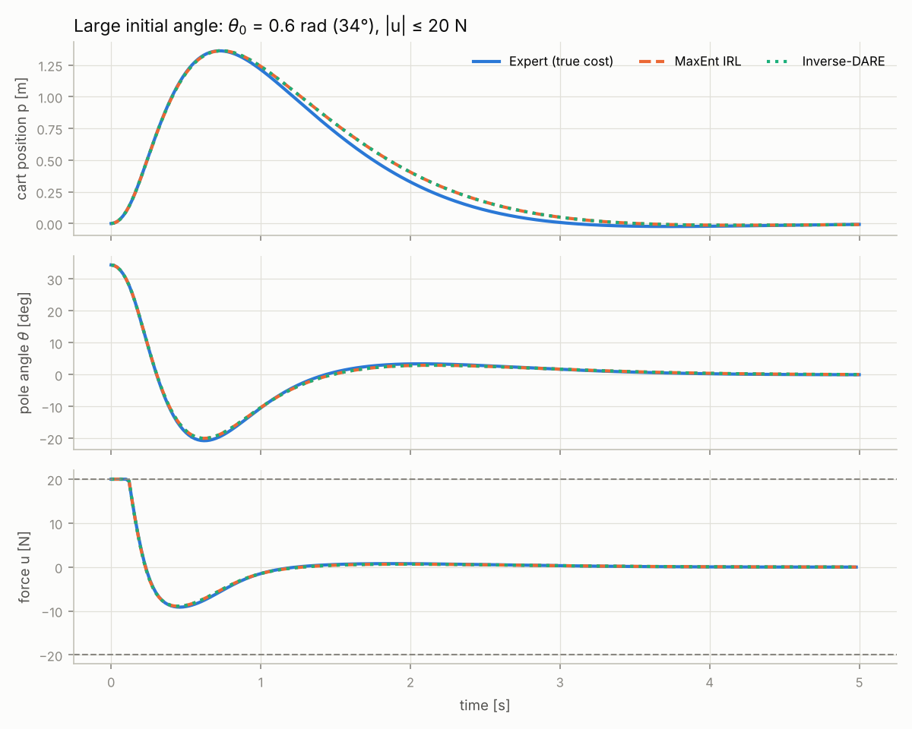
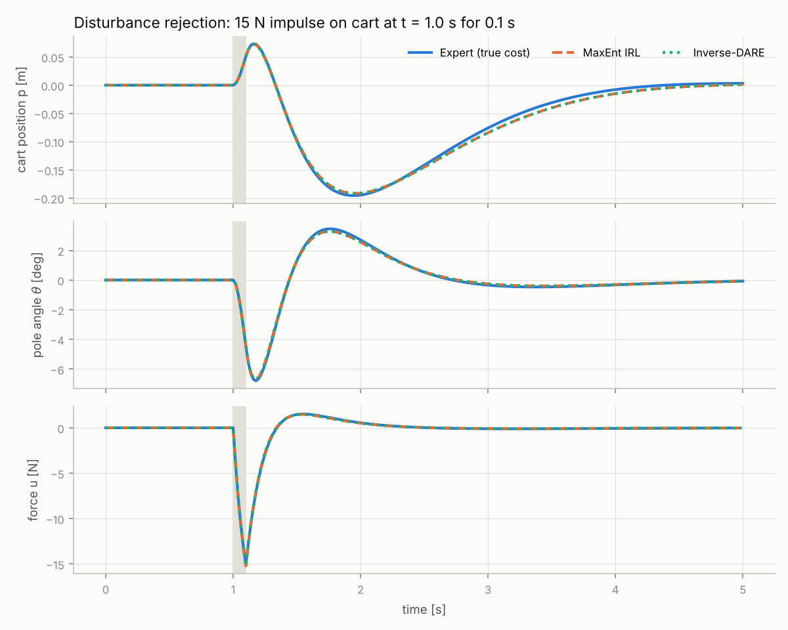
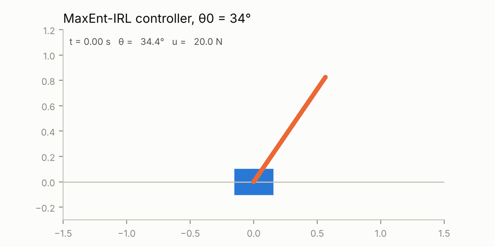

# Inverse RL 기반 도립진자(Cart-Pole) 제어기 설계 및 시뮬레이션

전문가(expert)의 시연 데이터 `(x, u)`만 보고 **숨겨진 비용함수(보상)를 역으로 추정(IRL)** 한 뒤,
추정한 비용으로 제어기를 다시 설계(forward RL = LQR)하여 비선형 cart-pole에서 검증한다.

```
pip install numpy scipy matplotlib pillow
python main.py          # 결과: results/*.png, results/cartpole_irl.gif, results/log.txt
```

## 구성
| 파일 | 내용 |
|---|---|
| `cartpole.py` | 비선형 cart-pole 모델 (M=1 kg, m=0.1 kg, l=0.5 m), RK4, 선형화, ZOH 이산화(dt=20 ms), 폐루프 시뮬레이션(\|u\| ≤ 20 N 포화) |
| `lqr.py` | 이산 LQR(DARE), MaxEnt 정책 공분산 `(R+BᵀPB)⁻¹`, 비용 계산 |
| `irl.py` | ① 시스템 식별(최소자승) ② **MaxEnt IRL** ③ **Inverse-DARE**(역최적제어) |
| `main.py` | 전체 파이프라인, 시뮬레이션 테스트, 그림/애니메이션 |

## 방법
1. **Expert**: 비공개 비용 `Q* = diag(5, 0.5, 50, 1)`, `R* = 0.1`의 LQR. MaxEnt(Boltzmann) 정책
   `u ~ N(-K*x, (R+BᵀPB)⁻¹)`로 비선형 플랜트에서 20개 에피소드(5000 샘플) 시연 생성.
2. **시스템 식별**: `x⁺ = Ax + Bu`를 최소자승으로 추정 (모델을 몰라도 됨).
3. **MaxEnt IRL**: LQ 문제에서 soft-optimal 정책은 가우시안 `N(-Kx, (R+BᵀPB)⁻¹)`이므로
   `θ = log[q₁..q₄, r]`에 대해 시연 로그우도를 최대화(BFGS, 매 평가마다 DARE 풀이).
   정책 노이즈 크기 덕분에 비용의 **절대 스케일까지** 식별된다.
4. **Inverse-DARE**: 시연에서 `K̂`를 회귀로 추정 후, 최적성 조건
   `(R+BᵀPB)K = BᵀPA`, `P = (A−BK)ᵀP(A−BK) + KᵀRK + Q` (K 고정 시 (P,Q)에 대해 선형)을
   `Q ⪰ 0` 제약 최소자승으로 푼다. K만으로는 스케일이 식별되지 않아 R을 고정.
5. 추정한 `(Q̂, R̂)`로 LQR 재설계 → 비선형 플랜트에서 검증.

## 결과 (`results/log.txt`)
| 가중치 | 참값 | MaxEnt IRL | Inverse-DARE |
|---|---|---|---|
| q_p | 5.0 | 4.47 | 4.47 |
| q_ṗ | 0.5 | 0.93 | 0.93 |
| q_θ | 50.0 | 51.5 | 51.5 |
| q_θ̇ | 1.0 | 0.99 | 0.99 |
| r | 0.1 | 0.100 | (고정) |

- 게인: `K* = [-6.14, -7.89, -57.44, -14.16]`, `K_IRL = [-5.79, -7.93, -58.18, -14.34]`
- 참 비용 기준 성능: 무작위 초기상태 100회 Monte-Carlo에서 IRL 제어기 비용이 expert 대비 **평균 +0.2%**
- 34° 초기각(입력 포화 포함), 15 N 충격 외란 모두 안정화
- q_ṗ 오차가 큰 이유: 카트 속도 가중치는 게인에 대한 민감도가 낮아(불량조건) 유한 시연으로 정확히 식별하기 어렵다.
  그래도 결과 제어기 성능은 거의 동일 — IRL은 "같은 행동을 낳는 비용"을 찾는다.
- 두 방법이 거의 같은 값을 주는 것은 정상이다: 가우시안 정책의 최대우도 평균 게인 = 최소자승 `K̂`.

| | |
|---|---|
|  |  |
|  |  |


